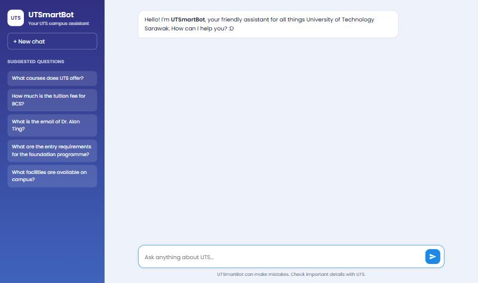
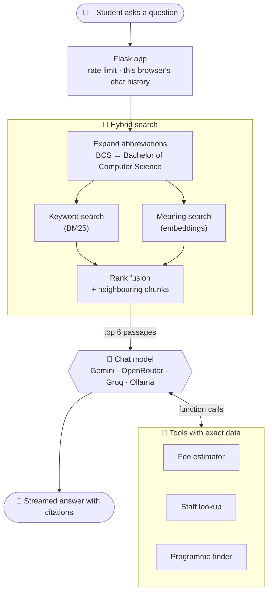
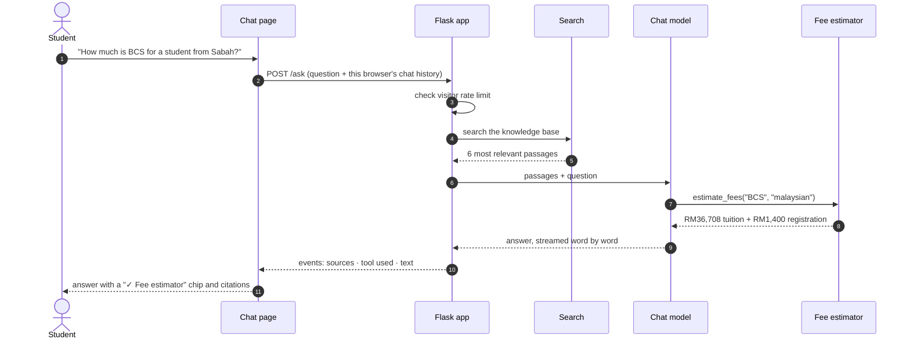
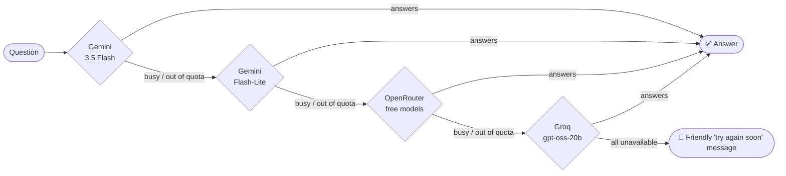
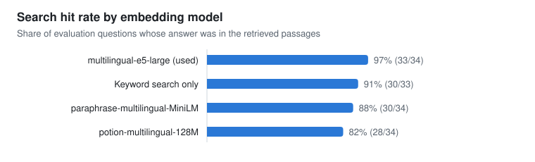
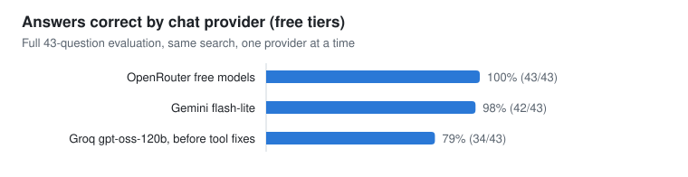
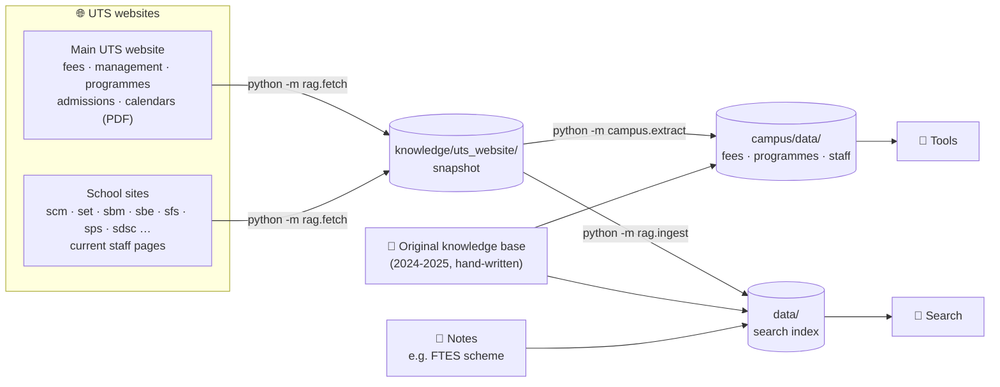

<div align="center">

# 🎓 UTSmartBot

**An AI campus assistant for the University of Technology Sarawak (UTS).**<br>
Ask about programmes, fees, scholarships, staff or campus life, in English, Malay or Chinese,<br>
and get answers with sources, exact fee calculations and up-to-date contacts.

[](https://utsmartbot.onrender.com)




<sub>The live demo runs on a free server: the first visit after a quiet spell takes about a minute to wake it up.</sub>

</div>

---

## ✨ What you can ask

| Ask UTSmartBot… | What happens behind the scenes |
|---|---|
| *"How much will BCS cost me in total? I'm from Sabah."* | 🧮 **Fee estimator** works out RM36,708 tuition + RM1,400 registration from the current fee schedule, in code, not by the AI |
| *"I'm from Sarawak. Is Computer Science free?"* | 🎁 Explains the **Sarawak Free Tertiary Education Scheme (FTES)** and who is eligible |
| *"Who is the Head of Programme for BCS?"* | 👩‍🏫 **Staff lookup** across 345 staff, preferring the 227 listed on the schools' current websites |
| *"I like computers and games. What should I study?"* | 🎯 **Programme finder** filters 36 programmes by interest, budget, level and qualification |
| *"When are the final exams this semester?"* | 📅 Searches the 2023-2027 **academic calendars** and cites them |
| *"Berapakah yuran pengajian untuk BCS?"* | 🌏 Replies in the language you write in |
| *"What is the WiFi password?"* | 🤚 Says it doesn't know instead of guessing |

Every answer shows which tool it used, links its sources, and names the AI model that replied.

---

## 🧠 How it works



### One question, step by step



### Never stuck on one AI provider

Free AI tiers run out quickly, so the bot tries providers in order and skips any that are busy or out of quota. It even takes over halfway through a tool call.



A provider that fails is skipped for a cooldown (10 minutes after a rate limit), so later questions don't wait on it.

---

## 📊 Measured, not guessed

Every design choice was tested on the evaluation set (`evals/`), a list of real UTS questions with known answers.

<picture>
  <source media="(prefers-color-scheme: dark)" srcset="docs/images/chart-context-size-dark.svg">
  
</picture>

<picture>
  <source media="(prefers-color-scheme: dark)" srcset="docs/images/chart-embedding-models-dark.svg">
  
</picture>

<picture>
  <source media="(prefers-color-scheme: dark)" srcset="docs/images/chart-providers-dark.svg">
  
</picture>

<sub>Measured on a 4-thread laptop CPU, 15-16 October 2026. The Gemini embedding model used on the live site scores the same as e5-large (36/37 on the current question set). Charts are generated by <code>docs/make_charts.py</code>.</sub>

---

## 🗂️ Where the knowledge comes from



Current website data always wins: older roles and fees are flagged or removed, so the bot doesn't quote a Head of Programme who changed in 2023.

---

## 🧰 Tech stack

| Layer | Technology |
|---|---|
| Web app | Flask 3, Gunicorn, server-streamed JSON events, vanilla JS with marked + DOMPurify |
| Search | `intfloat/multilingual-e5-large` via fastembed (local) or `gemini-embedding-001` (hosted), BM25, reciprocal rank fusion |
| Chat models | Google Gemini (google-genai SDK); Groq, OpenRouter and Ollama (OpenAI-compatible API) |
| Data | BeautifulSoup and pypdf parsers for the UTS website, JSON datasets for the tools |
| Quality | 54 unit tests, a 49-question evaluation set, provider check command |
| Hosting | Render free tier (`render.yaml`), Docker image for anywhere else |

---

## ⚡ Quick start

```bash
git clone https://github.com/ChrystalFSC/UTSmartBot.git
```
```bash
cd UTSmartBot
```
```bash
pip install -r requirements.txt
```

Copy `.env.example` to `.env` and add at least one free API key, for example `GEMINI_API_KEY` from [Google AI Studio](https://aistudio.google.com/app/apikey). Then start the app and open [http://127.0.0.1:5000](http://127.0.0.1:5000):

```bash
python UTSmartBot.py
```

The search index is already in `data/`. The first start downloads the local embedding model (about 2.2 GB) into `.models/`; to skip that, set `EMBEDDING_MODEL=gemini-embedding-001` in `.env`.

---

## 📚 Documentation

<details>
<summary><b>Project structure</b></summary>

```
UTSmartBot.py            Flask app: /, /ask (streaming), /healthz
rate_limit.py            Per-visitor and site-wide question limits
rag/fetch.py             Downloads the pages in knowledge/sources.txt
rag/documents.py         Loads knowledge files and splits them into chunks
rag/embeddings.py        Embedding backends: local open-source model or Gemini
rag/ingest.py            Builds the search index (python -m rag.ingest)
rag/retriever.py         Hybrid search used by the app
campus/extract.py        Builds structured data for the tools (python -m campus.extract)
campus/data/             programmes.json and staff.json used by the tools
campus/tools.py          Staff lookup, programme finder, fee estimator + their JSON schemas
llm/gemini.py            Gemini chat provider
llm/openai_compat.py     Groq / OpenRouter / Ollama chat provider (OpenAI-compatible API)
llm/router.py            Provider chain from LLM_CHAIN, with fallback and cooldowns
llm/check.py             Tests each provider, including tool calling (python -m llm.check)
knowledge/               Source documents (.md, .txt, .html, .pdf) + sources.txt URL list
knowledge/uts_website/   Snapshot of the UTS websites (python -m rag.fetch)
knowledge_archive/       Original 2024 knowledge base before outdated sections were removed (not indexed)
data/                    Search indexes, one per embedding model (committed, so deployments need no build step)
evals/                   Evaluation questions and runner (python -m evals.run)
tests/                   Unit tests (python -m unittest discover tests)
templates/, static/      Chat page and styles
docs/                    README screenshots and charts (python docs/make_charts.py)
Dockerfile, render.yaml  Deployment
```
</details>

<details>
<summary><b>Updating the knowledge base</b></summary>

The bot's information comes from three places:

| Source | What it holds | Refresh with |
|---|---|---|
| `knowledge/uts_website/` | Snapshot of www.uts.edu.my (fee schedule, management team, programmes, admissions, academic calendars as text) and the staff pages of the school and department sites (scm, set, sbm, sbe, sfs, sps, sdsc, cir, itd, arc) | `python -m rag.fetch` |
| `knowledge/UTS_knowledge_base.md` | The original 2024-2025 knowledge base: staff lists, entry requirements, facilities, hostel rules, policies | edit by hand |
| `knowledge/*.md` | Extra notes, e.g. the FTES scheme summary (a first line `Source: https://...` sets the citation link) | edit by hand |

Sections of the original knowledge base that the website now covers (fees, academic calendar, management team) were moved out so search cannot return the old figures; the untouched original is kept in `knowledge_archive/`, which is not indexed. Entry requirements on the website load by script, so they still come from the older knowledge base. Staff found on the current school pages are marked current and their phone numbers replace older ones; people listed only in the older knowledge base are flagged as possibly out of date. Emails that the school sites hide from automated readers are not decoded, so some current staff have no email in the data.

To refresh after UTS updates its website:
1. Download the pages listed in `knowledge/sources.txt` (add URLs there to include more pages; the sites' robots.txt files allow this):
   ```bash
   python -m rag.fetch
   ```
2. Rebuild the structured data for the tools and run the tests:
   ```bash
   python -m campus.extract
   ```
   ```bash
   python -m unittest discover tests
   ```
   The extractor prints anything it could not match (e.g. a programme without entry requirements) so it can be checked by hand. It also writes plain-sentence summaries of the fee schedule and management team (`knowledge/uts_website/summary_*.md`), which search finds far more easily than table cells. If UTS changed its figures, some tests will fail and show exactly what changed.
3. Rebuild both search indexes (only new or changed chunks are re-embedded):
   ```bash
   python -m rag.ingest
   ```
   ```bash
   EMBEDDING_MODEL=gemini-embedding-001 python -m rag.ingest
   ```
4. Check nothing got worse:
   ```bash
   python -m evals.run
   ```
   Use `--retrieval-only` for a quick search-only check, or `--only tool-` to run just the tool questions.

You can also drop your own `.md`, `.txt`, `.html` (saved from a browser) or `.pdf` files into `knowledge/` and run step 3.
</details>

<details>
<summary><b>Embedding models</b></summary>

Search uses **`intfloat/multilingual-e5-large`** by default, an open-source multilingual model (English, Malay, Chinese and more) that runs on your own machine with [fastembed](https://github.com/qdrant/fastembed). It is downloaded once (~2.2 GB) into `.models/` and then works offline, with no API key and no daily limit.

It was chosen by running the search evaluation (34 questions at the time) against each candidate on a 4-thread laptop CPU:

| Model | Search hit rate | Time per question | One-time indexing |
|---|---|---|---|
| `intfloat/multilingual-e5-large` (default) | **33/34** | 0.23 s | ~25 min |
| `sentence-transformers/paraphrase-multilingual-MiniLM-L12-v2` | 30/34 | 0.01 s | 25 s |
| `minishlab/potion-multilingual-128M` | 28/34 | < 0.01 s | 1 s |
| Keyword search only | 30/33 | – | – |

To use another model, set `EMBEDDING_MODEL` in `.env` and rebuild the index with `python -m rag.ingest`. `gemini-embedding-001` is limited to about 1,000 requests per day on the free tier but needs almost no memory, so the live site uses it. Each model has its own index file (`data/index-<model>.npz`); each index records the chunks it was built from, and the app refuses to start with an out-of-date index rather than giving silently bad search results.
</details>

<details>
<summary><b>Chat model providers and the fallback chain</b></summary>

Free tiers are limited (Gemini allows as few as 20 requests per day for `gemini-3.5-flash`, and a question that uses a tool takes two requests), so the bot can chain several providers:

| Provider | `LLM_CHAIN` entry | Key | Notes |
|---|---|---|---|
| Google Gemini | `gemini:gemini-3.5-flash` | `GEMINI_API_KEY` | Strong tool calling and Malay; low free daily limits |
| [Groq](https://console.groq.com) | `groq:openai/gpt-oss-20b` | `GROQ_API_KEY` | Very fast open models; free tier with per-model limits |
| [OpenRouter](https://openrouter.ai) | `openrouter:openrouter/free` | `OPENROUTER_API_KEY` | `openrouter/free` picks a free model that supports tools; free models change often |
| [Ollama](https://ollama.com) | `ollama:qwen3:4b` | none | Runs on your own machine; unlimited but slow without a good GPU |

Recommended `.env`:
```env
GEMINI_API_KEY=...
GROQ_API_KEY=...
OPENROUTER_API_KEY=...
LLM_CHAIN=gemini:gemini-3.5-flash,gemini:gemini-flash-lite-latest,openrouter:openrouter/free,groq:openai/gpt-oss-20b
```

How the chain behaves:
- Providers are tried in order; entries without an API key are skipped.
- A provider that fails is skipped for a while: 10 minutes after a rate limit (429), an hour after a credits or key error (402/401/403), and 1 minute after other errors.
- If a provider fails after calling a tool but before writing any answer (common when a free quota runs out on the second request), the next provider takes over without showing the tool twice.
- The last provider in the chain has nothing to fall back to, so on a short rate limit (Groq's per-minute token cap) it waits up to about a minute and retries instead of failing.
- Groq, OpenRouter and Ollama get a one-line reminder after each question to call the matching tool for fees, staff and programme lists; without it they often answered from the search passages. After three tool rounds the model must answer from what it has looked up.

**Provider comparison (16/10/2026, free tiers),** all 43 evaluation questions at the time, one provider at a time:

| Provider:model | Answers correct | Median / slowest answer | Notes |
|---|---|---|---|
| `openrouter:openrouter/free` | **43/43** | 22 s / 76 s | Calls the tools on every tool question; slow, because each request goes to whichever free model is available |
| `gemini:gemini-flash-lite-latest` | 42/43 | 3.2 s / 13 s | The one miss was a fee follow-up that ran out of tool rounds; it now has to answer instead |
| `groq:openai/gpt-oss-20b` | 7/7 tool + business questions* | 59 s / 80 s | Calls the right tool on every one |
| `groq:openai/gpt-oss-120b` | 34/43 before the tool fixes* | 1.4 s / 2.8 s | Often skipped the tools before the fixes; not re-measured |

\* Groq's free tier allows about 200,000 tokens per day and 7,000 input tokens per minute per model, and each question uses about 5,500 tokens, so a full run does not fit in one day. Groq works best as the last fallback.

After setting up keys, check which providers work (including tool calling):
```bash
python -m llm.check
```
To compare providers on the full evaluation, pin the chain to one of them, e.g. `LLM_CHAIN=groq:openai/gpt-oss-20b python -m evals.run`.
</details>

<details>
<summary><b>Deploy to Render (free)</b></summary>

[Render](https://render.com)'s free web service has 512 MB of RAM, which is too little for the local embedding model, so the deployment searches with **Gemini embeddings** (`EMBEDDING_MODEL=gemini-embedding-001`, using `data/index-gemini-embedding-001.npz`). In that mode the app uses about 135 MB. Everything is described in `render.yaml`.

1. Sign up at [render.com](https://render.com) with your GitHub account.
2. Click **New → Blueprint**, pick this repository and confirm. Render reads `render.yaml`.
3. When asked, enter the secrets `GEMINI_API_KEY`, `GROQ_API_KEY` and `OPENROUTER_API_KEY` (from your `.env`).
4. Wait for the first build (a few minutes), then open the `https://utsmartbot….onrender.com` link.

Every `git push` to `main` redeploys automatically. Free services sleep after 15 minutes without visitors; the next visit wakes them up, which takes about a minute. Search uses one Gemini embedding request per question (free tier: about 1,000 per day); if that runs out, search falls back to keywords until the next day.

**Usage limits.** A public link lets anyone use your API keys, so questions are limited per visitor and for the whole site (see `rate_limit.py`). Change the limits with environment variables (in Render: **Environment**), or `0` to turn one off:

| Variable | Default | Meaning |
|---|---|---|
| `RATE_LIMIT_PER_MINUTE` | 6 | Questions per visitor per minute |
| `RATE_LIMIT_PER_DAY` | 60 | Questions per visitor per day |
| `RATE_LIMIT_GLOBAL_PER_DAY` | 500 | Questions for the whole site per day |
</details>

<details>
<summary><b>Run with Docker, or deploy to Google Cloud Run</b></summary>

The Docker image includes the local embedding model (about 3 GB), so it needs at least 3 GB of RAM.

```bash
docker build -t utsmartbot .
```
```bash
docker run --rm -p 7860:7860 --env-file .env -e BEHIND_PROXY=0 utsmartbot
```
Then open [http://localhost:7860](http://localhost:7860).

Google Cloud Run needs billing enabled on the Google Cloud project (the free tier then covers small usage):
```bash
gcloud run deploy utsmartbot --source . --region asia-southeast1 --memory 4Gi --allow-unauthenticated --set-env-vars GEMINI_API_KEY=your_key
```
For production, store the keys in Secret Manager and use `--set-secrets` instead.
</details>

<details>
<summary><b>Testing and evaluation</b></summary>

```bash
python -m unittest discover tests
```
54 unit tests cover the extracted data (fees, FTES, staff merging), the tools, the provider fallback logic (with fake API clients), the search indexes and the rate limiter. They need no API key.

```bash
python -m evals.run
```
Asks the 49 evaluation questions through the real app and reports the search hit rate, the answer pass rate, which tools were called and which model answered. Each question lists the text the answer must contain, or marks it as one the bot should refuse to guess; tool questions also require the right tool to be called.
</details>

---

## 📝 Notes for evaluators and interviewers

- API keys live only in `.env`, which is excluded from version control; use your own keys (see `.env.example`) to run the app locally.
- Fees, staff and programme data come from the public UTS websites and may change; the bot cites its sources and suggests confirming important details with UTS.
- UTSmartBot is a personal project and is not an official UTS service.
